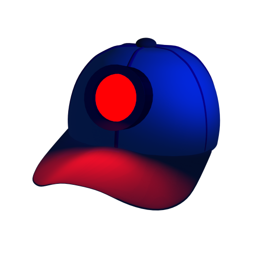
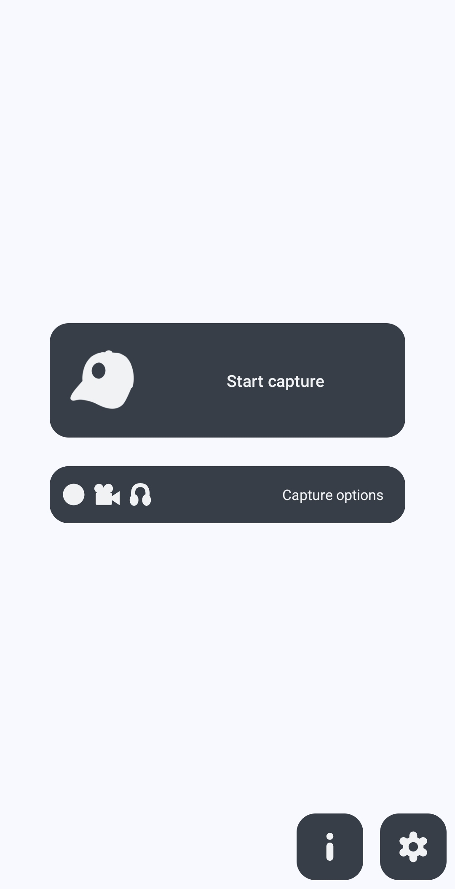
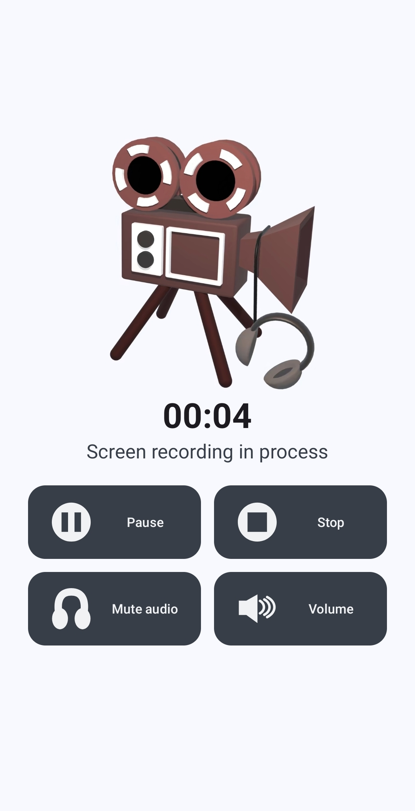
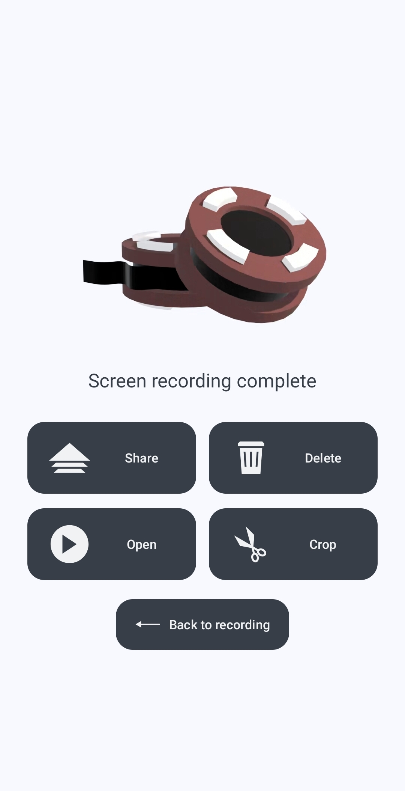

# CaptureCap

***Capture and Stream Android Screen and/or Audio.***

| :construction: Maintenance-Only Mode                                                                                  |
|:----------------------------------------------------------------------------------------------------------------------|
| This program has entered the Maintenance-Only Mode. For more information, please see [MAINTENANCE.md](MAINTENANCE.md) |

| :robot: AI Notice                                                                                  |
|:---------------------------------------------------------------------------------------------------|
| This program has code assisted/written by the AI. For more information, please see [AI.md](AI.md)  |

*Audio Playback recording requires Android 10 or later. No Root needed*

*(**WARNING**: Some device vendors may not allow recording certain Audio Playback sources, or even recording applications' audio at all)*

## Screenshots

  
